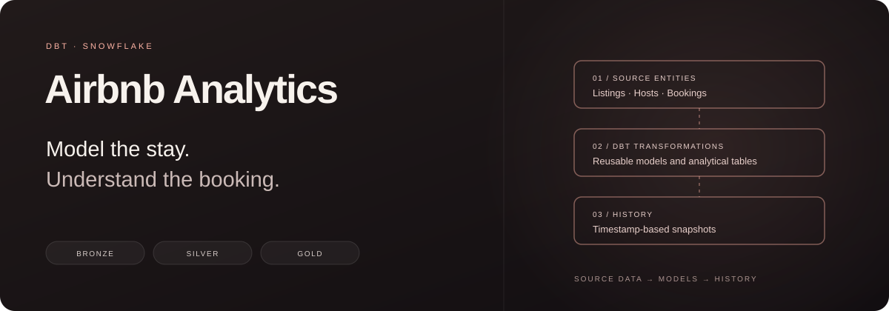
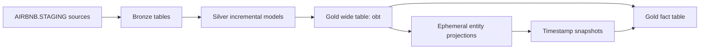

<p align="center"></p>
<p align="center">
  <a href="https://github.com/KhalidD0nc/airbnb-analytics-dbt/actions/workflows/ci.yml"></a>
  
  
  
  
</p>
<p align="center"><strong>From listings, hosts, and bookings to reusable analytics models.</strong></p>
<p align="center">
  <a href="#the-data-model">Data model</a> · <a href="#quick-start">Quick start</a> ·
  <a href="docs/ARCHITECTURE.md">Architecture</a> · <a href="docs/OPERATIONS.md">Operations</a> ·
  <a href="CONTRIBUTING.md">Contributing</a>
</p>

Airbnb Analytics is a dbt project for transforming Airbnb-style booking, listing, and host records in Snowflake. It demonstrates layered SQL modeling, reusable Jinja macros, a wide analytical table, and timestamp-based history snapshots.

This repository contains the transformation project. Source data must already be loaded into Snowflake; no Airbnb scraper, ingestion service, or source dataset is included. The Python `main.py` is a starter script; use the dbt CLI to run the models.

## The data model



This diagram shows the intended data flow. Some gold SQL uses fully qualified table names instead of `ref()`, so the current dbt graph does not encode every dependency. Follow the staged execution order below.

| Layer | Contents | Current materialization |
| --- | --- | --- |
| Bronze | Source bookings, hosts, and listings | Tables, as configured in `models/properties.yml` |
| Silver | Booking totals, listing attributes/price bands, and host attributes | Incremental models with entity unique keys |
| Gold | `obt` wide table and `fact` output | Tables |
| Entity projections | Booking, listing, and host fields used by snapshots | Ephemeral CTEs |
| History | `dim_bookings`, `dim_listings`, `dim_hosts` | Timestamp-based snapshots |

See [architecture and model boundaries](docs/ARCHITECTURE.md) for dependency, grain, and history details.

## Quick start

### 1. Install the locked environment

Use **Python 3.12** and [uv](https://docs.astral.sh/uv/).

```bash
git clone https://github.com/KhalidD0nc/airbnb-analytics-dbt.git
cd airbnb-analytics-dbt
uv sync --locked
```

The repository's Python package is named `airbnb-analytics-dbt`. The internal dbt project/profile remains `airbnb_dbt` so existing model references and project configuration retain their identity.

### 2. Configure Snowflake

```bash
cp .env.example .env
cp airbnb_dbt/profiles.yml.example airbnb_dbt/profiles.yml
```

Fill `.env` with your own Snowflake account, user, authentication, role, and warehouse settings. Both local files are ignored by Git. The profile reads credentials from environment variables; it contains no account password.

For the commands below, export the values from `.env` into your shell first. dbt does not automatically load `.env`. On macOS/Linux, you can instead use uv's explicit environment-file support:

```bash
uv run --env-file .env dbt debug --project-dir airbnb_dbt --profiles-dir airbnb_dbt
```

`dbt debug` connects to the configured account. Keep real credentials outside commits.

### 3. Prepare the source tables

The project expects three populated relations:

```text
AIRBNB.STAGING.LISTINGS
AIRBNB.STAGING.BOOKINGS
AIRBNB.STAGING.HOSTS
```

Their required columns are listed in [the operations guide](docs/OPERATIONS.md#source-tables). The repository does not create or populate these source tables.

### 4. Run in dependency order

After loading the sources, use this order from the repository root:

```bash
uv run --env-file .env dbt run --project-dir airbnb_dbt --profiles-dir airbnb_dbt --select bronze silver
uv run --env-file .env dbt run --project-dir airbnb_dbt --profiles-dir airbnb_dbt --select obt
uv run --env-file .env dbt snapshot --project-dir airbnb_dbt --profiles-dir airbnb_dbt
uv run --env-file .env dbt run --project-dir airbnb_dbt --profiles-dir airbnb_dbt --select fact
```

The separate steps account for the fully qualified SQL references in `obt.sql` and `fact.sql`. A single unrestricted build is not the documented fresh-environment path. Current SQL and snapshots explicitly reference the `AIRBNB` database; changing only the profile database will not redirect all operations.

## Explore the transformations

- **Booking amounts:** rounded `NIGHTS_BOOKED × BOOKING_AMOUNT`, plus cleaning and service fees.
- **Listing price bands:** `low`, `medium`, and `high` bands using the `tag` macro.
- **Host attributes:** cleaned names and a response-rate quality label.
- **History:** three snapshots using configured creation timestamps as their change-detection columns.
- **Analytical outputs:** a wide booking/listing/host join and a fact query that also joins snapshot dimensions.

These are learning-project definitions. Review the response-rate CASE ordering, snapshot timestamps, and fact-table grain before using the outputs for reporting; [architecture](docs/ARCHITECTURE.md#current-modeling-boundaries) records the current behavior.

## Offline validation

No Snowflake account is needed to parse the project:

```bash
uv sync --locked
uv run dbt parse --project-dir airbnb_dbt --profiles-dir .github/dbt --no-partial-parse
uv run dbt ls --project-dir airbnb_dbt --profiles-dir .github/dbt --resource-type model snapshot
```

CI installs the locked dependencies and parses the dbt project on `main`, `development`, and `staging`. Parsing validates project configuration and resolvable dbt references; it does not execute SQL, validate data, or discover dependencies hidden in hardcoded relation names. No data-test definitions are currently checked in.

## Repository map

```text
airbnb_dbt/
├── models/
│   ├── bronze/          # Source-table copies
│   ├── silver/          # Entity transformations
│   └── gold/            # Wide/fact tables and ephemeral projections
├── snapshots/           # Timestamp-based dimension history
├── macros/              # Schema naming, multiplication, bands, and trimming
└── analyses/            # Ad hoc exploration SQL
docs/                    # Architecture and operational prerequisites
.github/                 # Offline CI and PR template
pyproject.toml           # Python tooling metadata
uv.lock                  # Locked dependency versions
```

## Development workflow

```text
feature/* → development → staging → main
```

Use `development` for reviewed integration, `staging` for release candidates, and `main` as the stable reference. These are source branches; they do not create separate Snowflake environments. The current fixed database/schema references require separate accounts or an explicit SQL configuration change for isolated live environments.

Read [CONTRIBUTING.md](CONTRIBUTING.md) before opening a change. This repository was previously named `AIRBNB_DATA_Project`; use the new clone URL for future work.
